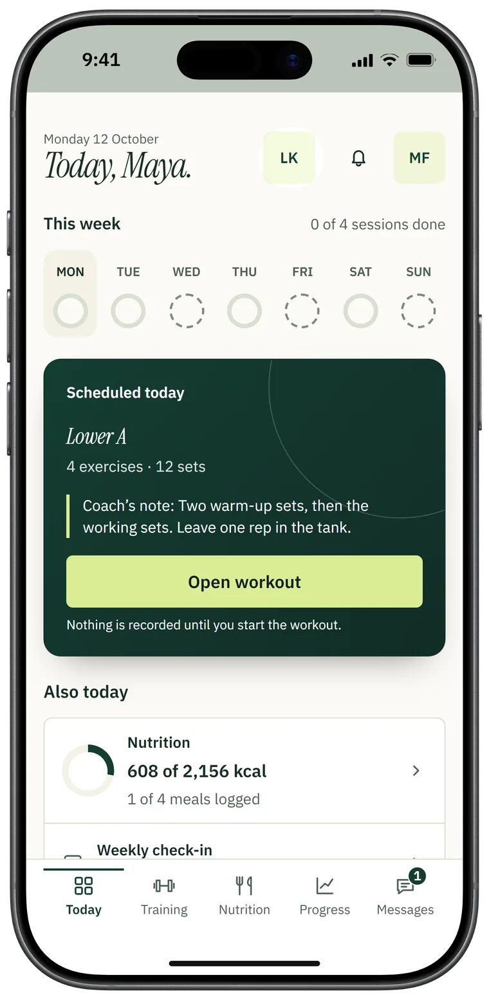
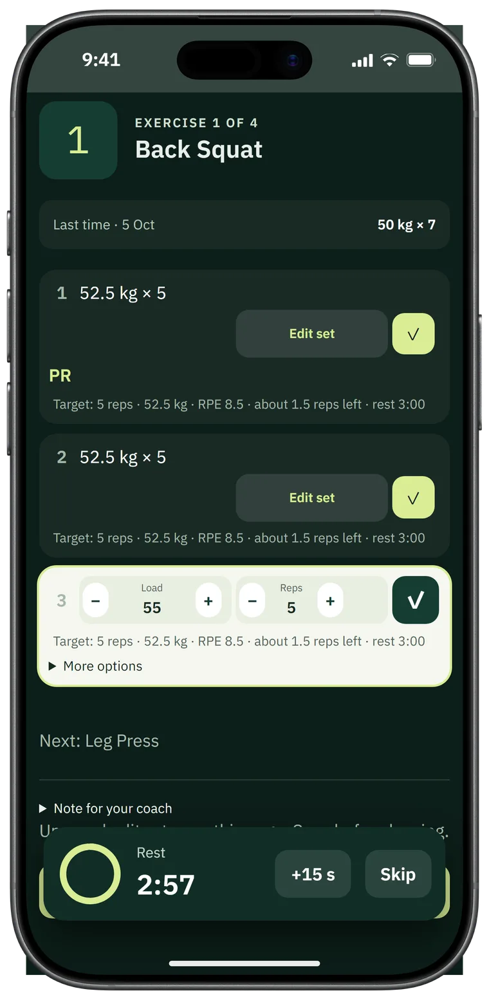
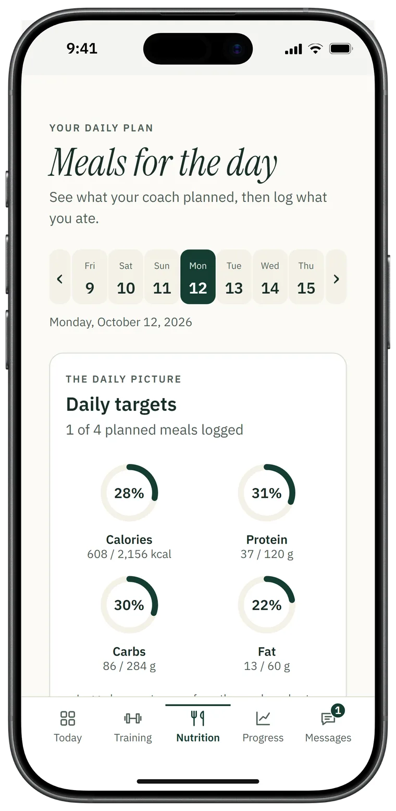
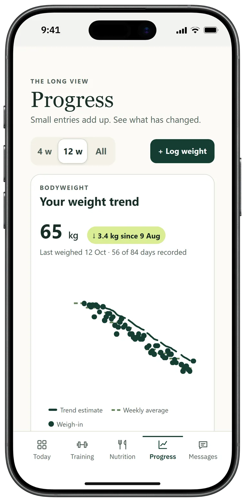
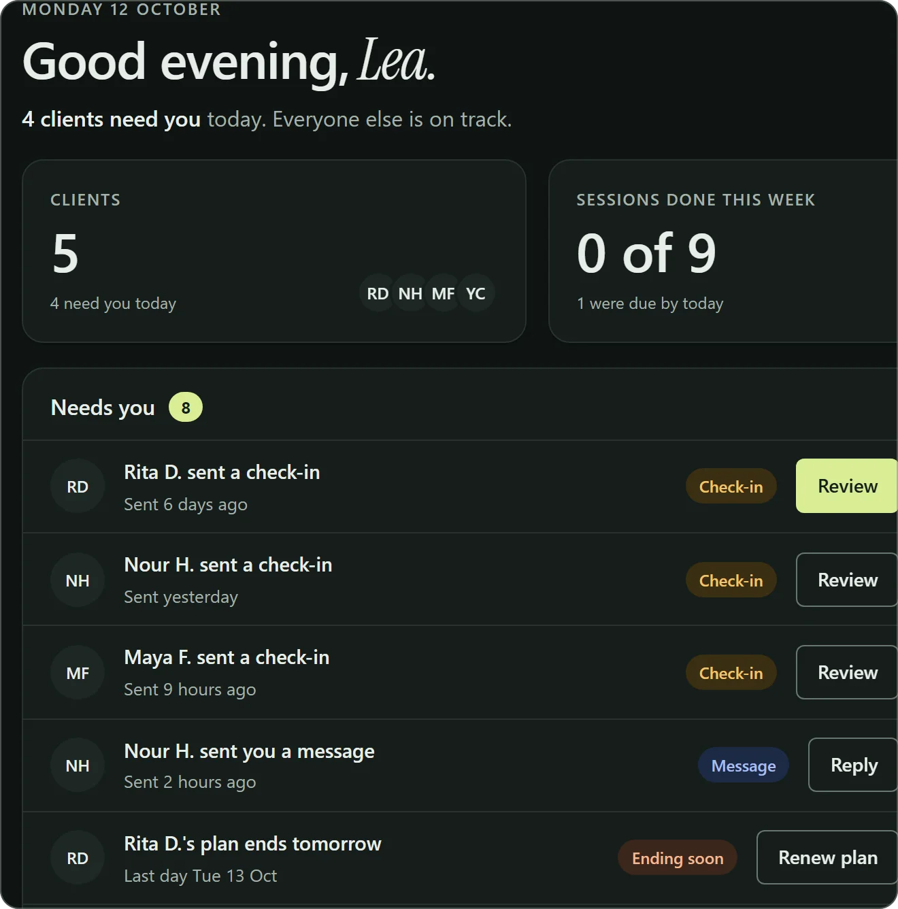
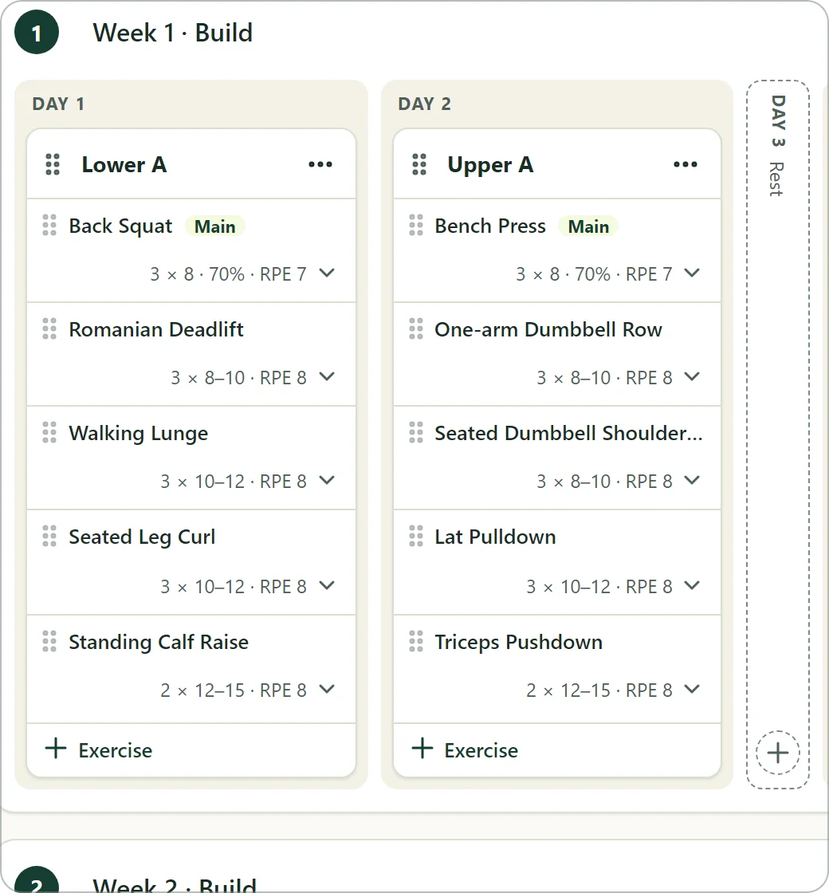
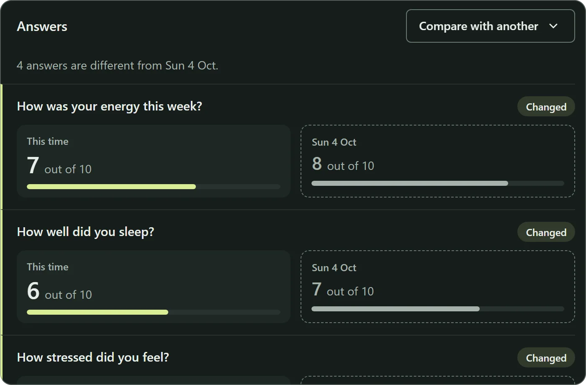
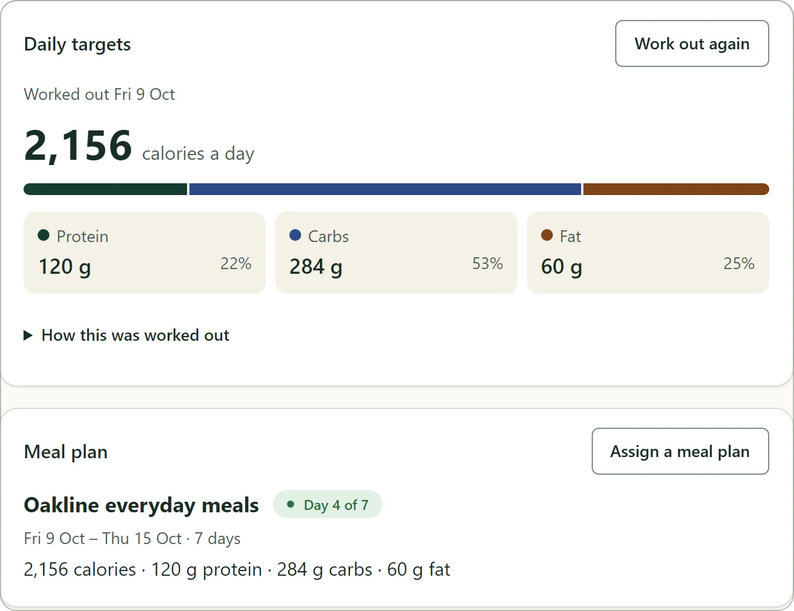
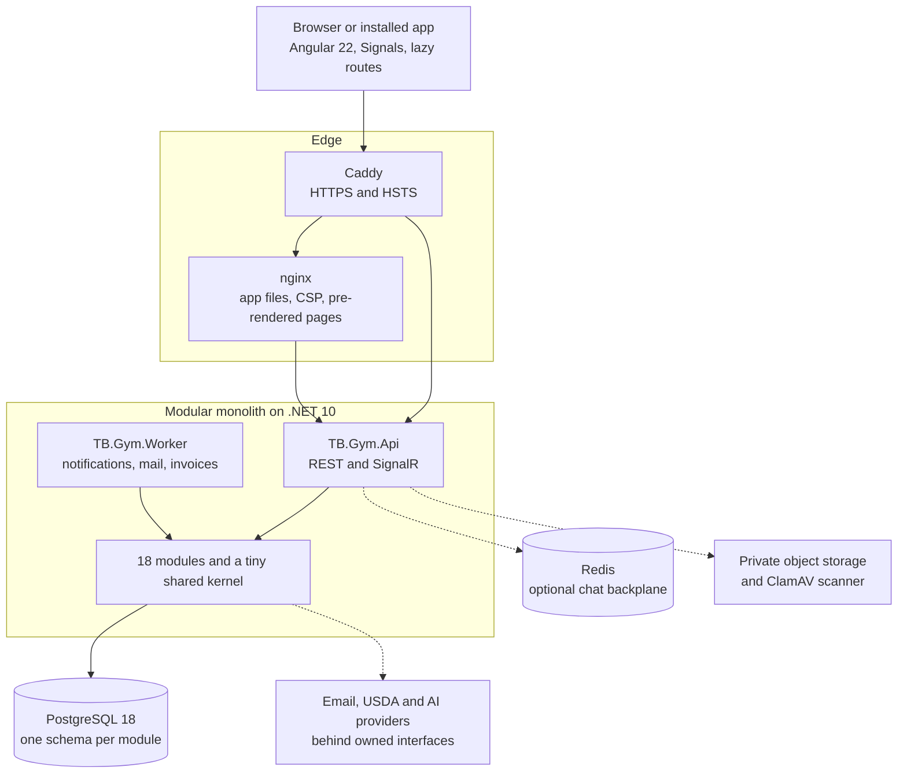

<div align="center">


# TB Gym

### The coaching platform for personal trainers and gyms

Programs, nutrition, check-ins, chat, plans and payments in one place:<br>
a workspace for coaches, and a phone-first app for their clients.


[What it does](#what-it-does) · [Engineering](#engineering-highlights) · [Architecture](#architecture) · [Testing](#testing) · [Status](#status) · [Run it](#run-it-locally)

</div>

<p align="center">
  
  
  
  
</p>

> [!NOTE]
> **Pre-launch.** The product is built and tested end to end, and a first outside coach has tried a test
> copy. It is not in production yet: [what is left](#status) is mainly deployment, email setup and
> legal review. Every picture here shows a demo workspace with made-up people.

<div align="center">

| **5,700+** | **18** | **280** | **75** | **230+** | **37** |
| :-: | :-: | :-: | :-: | :-: | :-: |
| automated tests | backend modules | API operations | database migrations | numbered domain rules | decision records |

</div>

---

## What it does

Each coach or gym gets a private workspace. Inside it, one product serves four kinds of people.

| Who | What they get |
| --- | --- |
| **Coach** | One page ranking who needs them today, then the tools to answer: a program builder, meal plans, check-in reviews, chat, plans and payments, all per client. |
| **Client** | An app built for the phone: today's workout, a fast set logger, meals and targets, weigh-ins, progress photos, check-ins and a direct line to their coach. |
| **Gym owner** | A team of coaches, each with their own clients, plus brand colours and logo, former clients and the bill. |
| **Platform admin** | Monthly usage invoices for every workspace, versioned price plans, legal documents and requests from new gyms. |

<table>
  <tr>
    <td width="50%"><br><sub><b>Coach Today</b> ranks what needs a coach now.</sub></td>
    <td width="50%"><br><sub><b>Program builder</b>: drag exercises into a weeks-by-days grid.</sub></td>
  </tr>
  <tr>
    <td width="50%"><br><sub><b>Check-in review</b> puts this week beside an earlier one.</sub></td>
    <td width="50%"><br><sub><b>Daily targets</b> that can show how they were worked out.</sub></td>
  </tr>
</table>

### The full feature list

<details>
<summary><strong>Coach Today and client management</strong></summary>

- **Today** ranks who needs attention: check-ins to review, messages, plans ending, weeks not yet shared and missed workouts.
- Money received this month per currency, active clients, plans ending in the next 14 days, plans that ended unrenewed, and a feed of finished workouts with their records.
- For an owner, This month also lists each coach with how many of their clients are active, and counts money across the whole workspace.
- **Clients list** with search and filters, and one page per client: status, what is waiting, plan, last workout and the week's sessions.
- Private coach notes, corrections to a client's intake, and finishing a profile on their behalf.
- **Invitations**: invite by email, send a new link (which stops the old one), cancel, or invite again. Refusals say why.

</details>

<details>
<summary><strong>Exercise library and program builder</strong></summary>

- A library per workspace with seven exercise types, muscles, movement patterns, equipment and tags. Search in any word order, filter, view as cards or a list, archive and restore.
- Demos from uploaded pictures and videos, or YouTube and Vimeo links shown under the video's own title.
- Approved alternatives on an exercise, so a program can offer safe swaps.
- A **weeks-by-days grid** with drag and drop, plus a press-to-add path for phones: up to 52 weeks, 14 workouts a week, 40 exercises a workout and 20 sets an exercise.
- **Set-by-set prescriptions**: reps or a range, set kind (warm-up, working, top, back-off, drop, failure), load, RPE or RIR, rest and tempo, with notes on the workout, the exercise and the set.
- **Five ways to set a load**: left to the client, typed, a percentage of the training max, or worked out from RPE on the RTS chart or the Epley curve.
- Saved workouts, and duplicating a week with progression across 1 to 12 copies.
- **Autosaved drafts** kept on the server and private to their author, a client's-eye preview, publish checks that jump to the problem, and numbered versions that never change.

</details>

<details>
<summary><strong>Running a client's program</strong></summary>

- Assigning gives the client **their own copy**, so later edits to the original never reach them. A program must fit inside a plan that includes training, and the client sees it once that plan is paid and has started.
- Load settings per client: kg or lb, the rounding step and direction.
- Share weeks one at a time, or open every shared week at once. The server hides the rest.
- Edit coming weeks and review every changed weight before applying, build the next block, reschedule, swap one coming workout, close or cancel, and read the program's history.
- **Training maxes** with their source and history. Logged sets can suggest a new max, but the coach reviews the new weights and applies it. Nothing changes on its own.
- Every calculated weight keeps its numbers on the server, and when a training max changes the coach can open "How it is worked out" on each new weight before applying it.
- Strength history per lift, estimated one-rep maxes, and prescribed against actual for any workout, including approved swaps.

</details>

<details>
<summary><strong>The client's Today and workout</strong></summary>

- **Client Today**: the week's sessions as rings, the workout scheduled today with the coach's note, nutrition so far, the check-in due first and the coach's latest message.
- See targets first; starting freezes what was prescribed for that workout.
- **Log a set in one tap**, with large steppers for weight and reps, and last time's numbers beside each set.
- A **rest timer** with a countdown ring, +15 s and Skip, counted from the clock so the time stays right even if the phone locks.
- Optional RPE (5 to 10) or reps left (0 to 5) in half steps, and kg or lb with no silent conversion.
- Approved swaps, demos, the coach's notes, and notes back to the coach.
- **Personal records** marked the moment a set beats the best for that lift, rep count and unit.
- A workout clock, swipe or button navigation, a finish summary, late workouts, and unfinished ones to pick up again.
- Typed sets survive a failed save and another open tab.
- **Share cards**: a record or a finished program as a picture in the coach's brand, drawn on the device and never uploaded.

</details>

<details>
<summary><strong>Nutrition</strong></summary>

- **Energy and macro targets** from Mifflin-St Jeor, revised Harris-Benedict or Katch-McArdle, with an activity model built on kind of work and daily steps. A second model version, which also counts weekly workouts, is built and runs in development.
- Every calculation shows its steps and inputs. Review ranges warn and never refuse, and a coach's own macros win.
- A **food library** with versions, USDA FoodData Central search and copy, label calorie checks, US or EU label counting, and the EU's 14 allergens.
- **Recipes** with live per-serving macros, private drafts, published versions, photos, and cooking conversions under a named source.
- A **meal plan builder**: a day and meal grid, drag and drop, several options per meal, each day measured against the target, plans of 1 to 365 days, and copying days and weeks.
- Assigning makes a client snapshot, and an allergen conflict stops until the coach reviews it. The app never calls a recipe safe.
- Clients see rings for the day, log planned meals, add extra food by hand, complete the day and print a recipe.
- **AI meal drafts** (off by default): a coach describes a meal, Claude suggests ingredients with the uncertain ones marked, and the coach matches each to a real food before anything is saved. Each workspace has a monthly allowance.
- **Nutrition settings** per workspace: how calories are counted, when a food's label calories get flagged, and the limit on AI suggestions.

</details>

<details>
<summary><strong>Progress and check-ins</strong></summary>

- Weigh-ins in kg or lb, corrected with a reason and a full history, and a smoothed weight trend over 4 weeks, 12 weeks or all time.
- Body measurements, and dated front, side and back photos with a compare slider and a before-and-after picture.
- A dashboard with weight, measurements, photos, records, completed against scheduled workouts and days logged.
- A **check-in form builder** with five question types, a ready weekly starter, and frozen published versions.
- Clients answer one question at a time, with answers saved as they go and an optional photo step.
- The **review page** shows answers beside an earlier check-in with the changes tagged, plus recent weight and photos, and a reply goes to the chat. Late check-ins count as overdue.
- No scores, streaks or adherence ratings, on purpose.

</details>

<details>
<summary><strong>Messaging and notifications</strong></summary>

- **Live chat** with no refresh, automatic reconnect and catch-up, and an honest offline state.
- Edit or take back your own message, unread counts, a New messages divider, and mark as unread.
- For coaches: inbox search, an Unread filter, up to 100 saved replies, a client panel beside the chat, and moderation with a recorded reason.
- Chat closes and returns with the client's plan. Chats stay private between the two people, so an owner cannot read another coach's.
- An in-app **notification inbox** with 14 kinds of notice, each opening the right screen.
- Per-workspace settings with opt-in plan emails and quiet hours, and a permanent record of consent. Email needs a configured provider.
- **Undelivered notices** for the owner: what TB Gym gave up delivering, when and why, with a reference to quote, and never who it was for or what it said.

</details>

<details>
<summary><strong>Plans and payments (coach to client)</strong></summary>

- **Plans you sell**, with price options by length and currency. Changing a price never touches clients already on it, and free plans are supported.
- What a client can open is decided feature by feature from the plans they hold, with the reason shown when something is closed.
- Starting a plan shows its dates and warns about a clash with a plan covering the same features.
- **Record payments by hand**, including part payments. Access opens only once the full price is in.
- Renew, pause and resume, cancel, and block a client in this workspace only.
- A client can read **My plan** and **Ask to renew**, which reaches the coach as a notice and a flag.

</details>

<details>
<summary><strong>Team, workspace and accounts</strong></summary>

- Owner, Coach and Client roles, one coach per client, and a coach reaches only their own clients.
- A **Team** page for the owner: each coach with their clients and join date, invitations still waiting, and a note that each coach is a seat on the bill.
- Invite a coach, or remove one, and their clients move to the owner. Move a client to another coach with their history in view.
- **End coaching** with a required reason. A former client's record stays read-only, and a returning client starts a new relationship.
- **Leaving is allowed too**: a client can stop on their own with an optional reason, and a coach can resign, which moves their clients to the owner.
- One account across several workspaces, with a separate role and data in each.
- Workspace name, time zone, first day of the week and currency.
- **Brand settings**: four presets or two colours of your own and a logo, with a preview of the coach's and the client's screens before saving.
- A five-step client intake that saves as it goes, and adults only.
- Email confirmation, sign-in refusals that name the real reason, an 8-hour or 30-day session, account lockout, password reset, and sign out everywhere.
- Versioned legal documents with recorded acceptance when joining. No legal wording ships in the code.

</details>

<details>
<summary><strong>TB Gym's own billing and the platform admin</strong></summary>

- One invoice a month per workspace, worked out from recorded usage at a versioned price plan, with a free trial.
- A Billing page for the owner alone, and clear banners before anything changes.
- **An overdue workspace turns read-only for staff.** Nothing is deleted, and clients keep full use.
- Platform admin: every workspace ordered by who needs attention, recording payments, void and reissue, dated discounts, and publishing price plans.
- **Legal documents**: publish a new version from reviewed text, see how often each was accepted, and stop asking for one published by mistake. Nothing is deleted.
- Payments are recorded by hand. There is no card processing yet.

</details>

<details>
<summary><strong>Public website and app shell</strong></summary>

- A **pre-rendered homepage** with a Talk to us form that keeps bots out with no CAPTCHA, and that stores a request even if its email cannot go out.
- Optional cookie-free analytics served through the app's own origin, so the Content Security Policy stays `script-src 'self'`.
- A public **What changed** page listing every change coaches and clients can see, newest first.
- **Light, dark or device theme**, following the account across devices.
- **Installable** to a phone's home screen, with an Install button where the browser allows it and the Share-menu steps on an iPhone.
- Separate coach and client navigation, lazy feature routes, and a shared kit of about 40 components.
- Unsaved work is protected: leaving a page by link, Back, a workspace switch, sign-out or a reload asks first.

</details>

---

## Engineering highlights

The interesting problem here is not the CRUD. A coaching platform holds money, health data and private
conversations for many independent businesses in one database, and in each of those "mostly correct" looks
exactly like broken until somebody is harmed by it.

So the approach is simple: **the database enforces the invariants, and the application is not trusted to
remember them.**

**Tenant isolation is structural.** Every tenant-owned entity has a required `TenantId` and a deny-by-default
query filter, and a `SaveChanges` guard refuses any write outside the active workspace. Foreign keys between
tenant-owned tables are composite and carry the workspace, so one cannot point at another workspace's parent,
even by direct SQL. `X-Tenant-Id` is treated as a request, not a fact, and is checked against an active
membership every time. Architecture tests assert these rules over the built EF
model, and cross-workspace refusal is tested throughout the integration suite.

**History is append-only where it matters.** Payments, price changes, invoices, strength maxes, message
revisions and legal acceptances are never edited or deleted. Database triggers refuse `UPDATE` and `DELETE`, so
application code and background jobs cannot rewrite the record. Corrections append.

**Concurrency is settled in PostgreSQL.** GiST exclusion constraints make it impossible for a client to hold two
plans covering the same feature, two programs or two meal plans on the same date. Idempotency keys are bound to the normalized payload, so a retry replays the first result and
a reused key with changed content conflicts. Background work claims rows with `FOR UPDATE SKIP LOCKED` under a
random token and a lease, so a crashed claim becomes visible again. The hardest races are held open with
deterministic barriers, and those tests fail if the two sides never really contended.

**Money is exact.** Decimal amounts with currency: a typed price or receipt with a fraction of a cent is refused,
never rounded. Offers are frozen once sold, renewal creates a new enrollment, and a part payment grants nothing
until the price is met. Platform invoices are frozen snapshots, and the database re-checks their arithmetic.

**Calculations explain themselves.** Formulas and policies are named, versioned and stored with their inputs.
The RPE chart's 96 cells are locked by a reference test and cross-checked against a peer-reviewed table where
they overlap. Kilograms and pounds are never silently converted, and a coach's manual override always wins.

**Claims are only made when they can be substantiated.** A committed message is `Persisted`, not `Delivered`. A
frame the hub accepted is `Published`, which says nothing about a browser. An acknowledgement says the other
app merged it, not that a person read it. Those are separate durable facts, and no code path writes one from
another, because "delivered" recorded as "read" is a bug you cannot see from the UI.

**Private by construction.** Client photos are re-encoded from pixels and the original upload is deleted, so
EXIF and GPS are not kept. Media is served only through the API after a per-request check: no public bucket,
CDN or presigned URL. Queued notifications hold identifiers, not content. Email suppression stores a keyed fingerprint, never an address.
Invitation tokens are stored only as hashes. Tests inspect captured logs to prove what stays out of them.

**Production fails closed.** Startup refuses seed data, migrate-on-startup, localhost origins, half-configured
providers and the captured mail adapter, with a message that names the setting and never quotes a secret. Only
the edge publishes ports, and a test reads the production compose file to hold that.

**AI output is untrusted input.** It must pass an owned schema, and nothing reaches the library until a coach
picks a real food for every line. Spend is reserved before any billed call under a per-workspace lock. The
prompt carries only the coach's description, and the SDK stays behind one adapter.

**Correctness is argued in writing first.** [37 decision records](docs/adr/) capture the reasoning, often with
the alternatives rejected, and [230+ numbered rules](docs/DOMAIN-RULES.md) state what the code and the schema must
both uphold.

---

## Architecture

A modular monolith: one API, one worker, one database. Module assemblies cannot reference each other, which keeps
the boundaries honest. They share one database context, so extracting a module would be a real project, taken
on only if evidence ever justifies the cost of distributing it.



| Area | Modules |
| --- | --- |
| People | Identity, Tenancy, Clients, Invitations |
| Coaching | Training, Strength, Exercise Library, Nutrition, Progress, Check-ins |
| Money | Subscriptions, Platform Billing |
| Communication | Messaging, Notifications |
| Platform | Media, Website, Integrations (provider interfaces), Gamification (reserved, not built) |

A module owns its entities, tables and vocabulary, and may reference only the shared kernel, never another
module. Architecture tests enforce that on the built assemblies rather than by convention. Work that crosses
modules sits in `TB.Gym.Infrastructure`, the layer that composes them, and shared rules such as feature access
go through narrow contracts.

`TB.Gym.Worker` is a second composition root of the same monolith, not a microservice: same database, same
domain assemblies, same tenant guards, no HTTP surface, and CI inspects its built image to prove that. It runs
notification dispatch, mail and platform invoicing. Realtime publication stays in the API, because it needs
connections to publish to.

| Layer | Choice |
| --- | --- |
| API | .NET 10, C# 14, ASP.NET Core minimal APIs, SignalR |
| Data | EF Core 10, Npgsql, PostgreSQL 18 |
| Frontend | Angular 22 standalone components, Signals, strict TypeScript, generated API client |
| Auth | ASP.NET Core Identity, HTTP-only same-origin cookies, antiforgery on writes |
| Testing | MSTest, Vitest, Playwright, axe |
| Hosting | Docker Compose: Caddy, nginx, API, Worker, PostgreSQL, ClamAV and encrypted nightly backups |
| Providers | Resend, Cloudflare R2, USDA FoodData Central and Anthropic, each behind an owned interface. Off in development until configured; production requires Resend and defaults to R2 |

---

## Testing

**5,753 automated tests**, written beside the features they protect, plus 426 of them run a second time at UTC+14.

| Layer | Tests | Runs against | What it proves |
| --- | --: | --- | --- |
| Domain | **759** | Plain .NET | Rules, state changes, formulas and every cell of the calculation tables |
| Architecture | **57** | Built assemblies, the EF model, compose and nginx files | Module boundaries, tenancy rules on every entity, provider isolation, what the edge exposes |
| API integration | **952** | Real PostgreSQL 18, real WebSockets, real Redis containers | Whole flows, wrong-workspace refusals, races, database guards, migration upgrades and reverts, multi-replica chat |
| Angular unit and component | **3,358** | Vitest, in 271 spec files | Screen state, interaction, view models and the design kit |
| Browser, mocked API | **526** | Playwright and axe | Screens at phone and desktop widths with accessibility checks, 13 of them on the production build, and 46 committed screenshot baselines |
| Browser, live stack | **49** | Playwright, a real API and database | Sign-in, invitations, workouts, chat, cross-workspace security and an accessibility sweep through the real server |
| Private build and edge | **10** | Playwright | The private pre-launch build, and nginx's headers, cache rules and CSP |
| Build scripts | **42** | `node --test` | The pre-render check, home page style inlining, the private build, the picture pipeline and the legacy-style lint |

The 1,768 backend tests and 3,358 Vitest tests all passed on this code, with none skipped. Browser suites
run by hand against each changed area.

**Every push to `main` and every pull request runs CI:**

- **Backend:** analyzers, a Release build where any warning fails, the backend suite on PostgreSQL and Redis (a
  pull request that only touches the web app or docs skips the integration tests), a check that the EF model and
  migrations agree, and a migration bundle that must migrate a fresh database. A missing database fails the run
  rather than skipping tests.
- **Web:** Prettier, ESLint, a lint that refuses legacy styles, a production build with size budgets, a check of
  the pre-rendered pages, Vitest and `npm audit`.
- **Containers:** builds the API, Worker and web images, checks that the Worker image declares no port and ships
  no SignalR or Redis client, proves the API refuses several replicas without a backplane and starts with one, and
  validates `compose.yaml`.

---

## Status

**Built and tested:** everything in the feature list above, across 280+ commits in eleven weeks.

**In progress:** session packs for in-person 1-on-1 sessions, and the last fixes from the first outside coach's
hands-on review.

**Before real customers:**

- First production deployment: domain, server, and edge checks on the real host.
- A verified sending domain for email, a real provider send, and a restore drill on the server.
- Media storage and scanning, proven on the real host.
- Legal review of the terms, privacy policy and health consent.
- An independent review of the energy model, which stays on its first version in production until then.
- Self-service data export and account deletion.

**Not built yet:** online or recurring payments, refunds, WhatsApp delivery, an Arabic interface, gamification,
offline workout logging, two-factor sign-in, supersets and timed sets.

The go-live stack is prepared and has been run locally, but it has never been deployed to a real server.

---

## Run it locally

Docker Compose is the shortest complete path. It starts PostgreSQL, Redis and ClamAV, applies migrations,
starts the API and Worker, and serves Angular through nginx. ClamAV needs about 4 GiB of memory.

```powershell
Copy-Item .env.example .env    # set POSTGRES_PASSWORD, and TB_GYM_ADMIN_PASSWORD if seeding
docker compose up --build
```

The app is at <http://localhost:4200> and the API at <http://localhost:5134>, with `/health/live` and
`/health/ready`. Register a coach from the sign-in screen to create a workspace. In development, the captured
mail adapter gives you the confirmation and invitation links, so the whole flow works with no email provider.

To see the product with realistic data, fill the development database with the Atlas Performance demo: an owner,
two coaches and twelve clients with about ten weeks of history, built through the application's own services.

```powershell
.\scripts\demo-workspace.ps1    # stop a running API first; it prints the sign-ins
```

To run the backend suite and the web checks:

```powershell
.\scripts\check.ps1
```

This builds the solution in Release, runs the backend suite, then checks Angular formatting and lint, builds it,
runs Vitest and audits npm dependencies. With Docker running, the backend suite uses a throwaway in-memory
PostgreSQL and takes about 35 minutes.

## Documentation

| Document | Contents |
| --- | --- |
| [ARCHITECTURE.md](docs/ARCHITECTURE.md) | Module boundaries, persistence and security architecture |
| [DOMAIN-RULES.md](docs/DOMAIN-RULES.md) | Numbered business rules and invariants |
| [docs/adr/](docs/adr/) | Decision records, many with the alternatives rejected |
| [AGENTS.md](AGENTS.md) | Coding standards and constraints across the repository |

The `base44/` folder keeps the earlier prototype as a reference only. It is not part of this architecture.

<sub>© 2026 hicham004. All rights reserved. The source is public for review; no licence to reuse it is granted.</sub>
